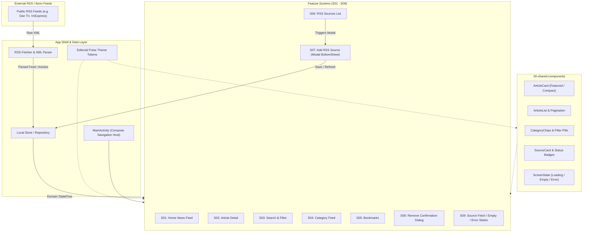

# Project Context: RSS News Reader (Android Frontend)

## System Overview
- **Platform**: Android
- **Language**: Kotlin
- **UI Framework**: Jetpack Compose with Material 3 (`androidx.compose.material3`, Compose BOM 2024.12.01)
- **Architecture Pattern**: MVVM with Repository pattern, Kotlin Coroutines, and `StateFlow`
- **Design System**: Editorial Pulse (`DESIGN2.md` / `DESIGN2_IMPLEMENTATION.md`)
  - Primary Teal (`#005C55` / `#0F766E`), Slate Canvas (`#F8FAFC`), Elevated Cards (`#FFFFFF`)
  - Typography: Plus Jakarta Sans (Headlines/Actions) & Inter (Body/Metadata)
- **Data & Network Architecture**:
  - Direct on-device RSS/Atom XML feed fetching and parsing.
  - Local persistence (Room database / local repository as single source of truth).
  - No remote aggregator backend service required.
- **Current Status**:
  - Gradle multi-module / Android app project established (`app/build.gradle.kts`, `MainActivity.kt`).
  - CI/CD workflow configured (`check-docs.py`, Android build pipeline in `.github/workflows/ci.yml`).
  - App shell migrated to Jetpack Compose with 4 bottom navigation tabs (Home, Explore, Saved, RSS Sources).
  - Feature screens `S01`–`S09` are defined in `src/` guides and ready for implementation.

## Current Architecture & Data Flow

## Module Structure
- `app/`: Main Android application module containing `MainActivity.kt`, theme setup, Gradle scripts.
- `src/00-app-shell`: Navigation routes, core theme, on-device RSS fetcher, shared domain models (`Article`, `Category`, `RssSource`).
- `src/00-shared-components`: Shared UI widgets (`ArticleCard`, `CategoryChip`, `ScreenState`).
- `src/S01-home-news-feed`: Latest articles, category tabs, pull-to-refresh.
- `src/S02-article-detail`: Article reader with thumbnail, metadata, bookmark toggle, open original link in browser.
- `src/S03-search-filter`: Query search and category/source filtering.
- `src/S04-category-feed`: Category-specific feed.
- `src/S05-bookmarks`: Saved articles list and local bookmark management.
- `src/S06-rss-sources`: RSS sources management list.
- `src/S07-add-rss-source`: Add source modal bottom sheet (URL validation, preview, category picker, submit).
- `src/S08-remove-source-confirmation`: Modal dialog for removing source.
- `src/S09-fetch-status-states`: Polling and fetch status visualization.

## Technical Considerations & CI Requirements
1. **No Backend API Dependency**: Strictly no backend REST service reference; all network calls are direct RSS feed requests on device.
2. **CI Check Compliance**: `python3 scripts/ci/check-docs.py` verifies no leftover backend markers exist across any markdown file.
3. **Jetpack Compose**: All screens and shared UI components use Jetpack Compose, Material 3, and Kotlin Coroutines/StateFlow.
