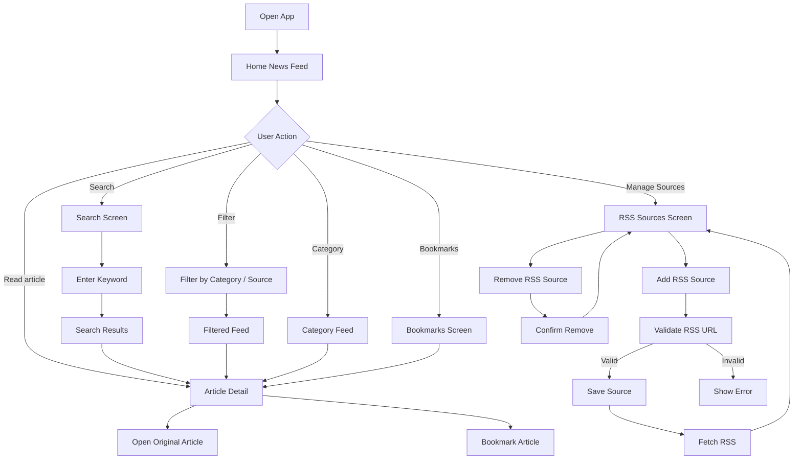
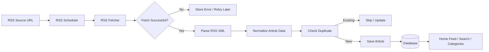
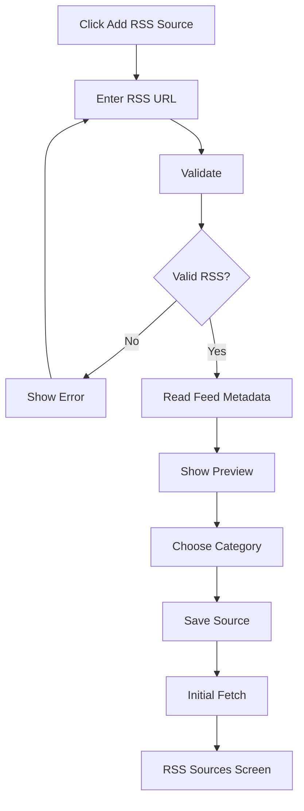
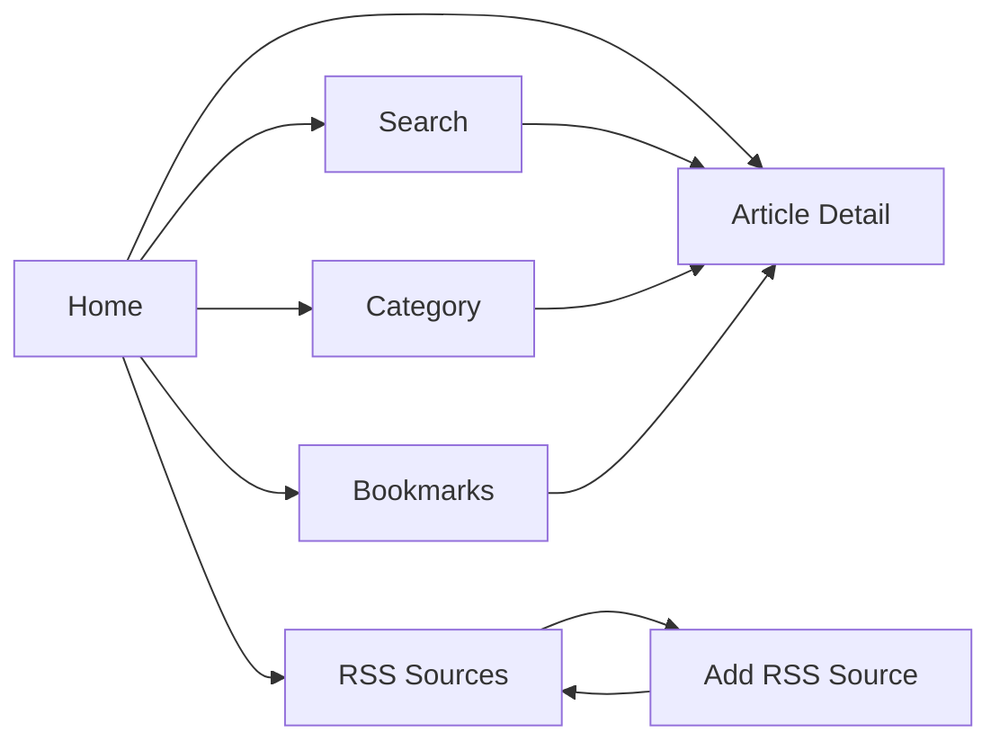
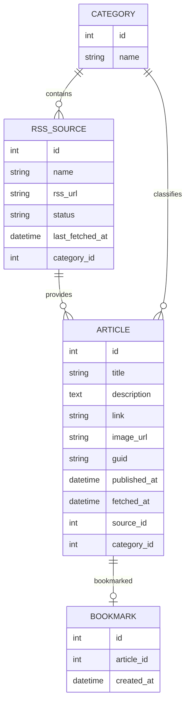

# RSS News Reader — FLOW & WIREFRAME

> **Project type:** Course assignment — RSS Feed Reader  
> **Primary RSS source:** Dân trí — https://dantri.com.vn/rss.htm  
> **Scope:** Add / Remove RSS Sources, Automatic RSS Fetching, Home News Feed, Article Detail + Original Link, Search & Filter, Bookmark, Basic Categories.

---

# 1. PROJECT SCOPE

Ứng dụng là một **RSS News Reader** cho phép người dùng quản lý các RSS feed, tự động lấy bài viết mới và đọc/tìm/lưu bài viết trong một giao diện thống nhất.

Nguồn RSS chính của đồ án là **Dân trí**, với các feed theo chuyên mục như:

- Trang chủ
- Thời sự
- Thế giới
- Đời sống
- Thể thao
- Giáo dục
- Kinh doanh
- Giải trí
- Sức khỏe
- Công nghệ
- Khoa học
- Và các chuyên mục RSS khác do Dân trí cung cấp

## 1.1 Features in Scope

1. **Add RSS Source**
2. **Remove RSS Source**
3. **Automatic RSS Fetching**
4. **Home News Feed**
5. **Article Detail**
6. **Original Article Link**
7. **Search Articles**
8. **Filter Articles**
9. **Bookmark Article**
10. **Basic Categories**

## 1.2 Out of Scope

Để giữ đúng phạm vi đồ án RSS cơ bản, phiên bản đầu **không cần**:

- AI Summary
- Recommendation Engine
- Semantic Search
- Comments
- Social features
- User-to-user following
- Complex notification system
- News clustering
- Full article scraping
- Admin CMS phức tạp

---

# 2. INFORMATION ARCHITECTURE

```text
RSS News Reader
│
├── Home
│   ├── Latest News
│   ├── Category Filter
│   ├── Source Filter
│   └── Article Card
│
├── Categories
│   ├── Thời sự
│   ├── Thế giới
│   ├── Kinh doanh
│   ├── Thể thao
│   ├── Công nghệ
│   └── ...
│
├── Search
│   ├── Search Input
│   ├── Category Filter
│   ├── Source Filter
│   └── Search Results
│
├── Bookmarks
│   └── Saved Articles
│
├── RSS Sources
│   ├── Source List
│   ├── Add RSS Source
│   └── Remove RSS Source
│
└── Article Detail
    ├── Article Information
    ├── RSS Content / Description
    ├── Bookmark
    └── Open Original Article
```

---

# 3. MAIN APPLICATION FLOW



---

# 4. RSS DATA FLOW

Đây là flow chạy phía backend và không nhất thiết có một screen riêng.



## 4.1 Suggested Article Data

```text
Article
├── id
├── title
├── description
├── link
├── image_url
├── published_at
├── source_id
├── category_id
├── guid
└── fetched_at
```

## 4.2 Suggested RSS Source Data

```text
RSSSource
├── id
├── name
├── rss_url
├── category
├── status
├── last_fetched_at
└── created_at
```

---

# 5. SCREEN LIST

| # | Screen | Purpose |
|---|---|---|
| S01 | Home News Feed | Hiển thị tất cả bài viết mới |
| S02 | Article Detail | Xem chi tiết một bài RSS |
| S03 | Search & Filter | Tìm kiếm và lọc bài viết |
| S04 | Category Feed | Xem bài theo chuyên mục |
| S05 | Bookmarks | Xem các bài đã lưu |
| S06 | RSS Sources | Quản lý các nguồn RSS |
| S07 | Add RSS Source | Thêm một RSS feed |
| S08 | Remove RSS Confirmation | Xác nhận xóa source |
| S09 | RSS Fetch Status / Empty States | Trạng thái cập nhật và lỗi |

---

# 6. GLOBAL LAYOUT

Các màn hình chính sử dụng chung layout.

```text
┌───────────────────────────────────────────────────────────────────────┐
│ RSS READER                  [ Search articles... ]           [ ☰ ]    │
├────────────────┬──────────────────────────────────────────────────────┤
│                │                                                      │
│  HOME          │                                                      │
│                │                                                      │
│  CATEGORIES    │                PAGE CONTENT                          │
│   • Thời sự    │                                                      │
│   • Thế giới   │                                                      │
│   • Kinh doanh │                                                      │
│   • Thể thao   │                                                      │
│   • Công nghệ  │                                                      │
│                │                                                      │
│  BOOKMARKS     │                                                      │
│                │                                                      │
│  RSS SOURCES   │                                                      │
│                │                                                      │
├────────────────┴──────────────────────────────────────────────────────┤
│                              Footer                                   │
└───────────────────────────────────────────────────────────────────────┘
```

> Có thể dùng **sidebar desktop** và chuyển thành **bottom navigation / hamburger menu** trên mobile.

---

# 7. S01 — HOME NEWS FEED

## Purpose

Hiển thị các bài mới nhất từ tất cả RSS source đang được subscribe.

## User Actions

- Xem danh sách bài
- Click bài để xem Article Detail
- Bookmark bài
- Chọn category
- Chọn source
- Search
- Refresh feed

## Flow

```text
Home
 ↓
Load cached articles from database
 ↓
Sort by published_at DESC
 ↓
Display News Feed
 ↓
User selects article
 ↓
Article Detail
```

## Wireframe

```text
┌────────────────────────────────────────────────────────────────────────┐
│ RSS READER                   🔍 Search articles...                      │
├─────────────────┬──────────────────────────────────────────────────────┤
│                 │                                                      │
│  🏠 Home        │  HOME                                                │
│                 │                                                      │
│  Categories     │  Latest News                           ↻ Refresh      │
│  ─────────────  │                                                      │
│  Thời sự        │  [All] [Thời sự] [Thế giới] [Kinh doanh] [...]      │
│  Thế giới       │                                                      │
│  Kinh doanh     │  Source: [ All Sources ▼ ]                           │
│  Thể thao       │                                                      │
│  Công nghệ      │  ┌───────────────────────────────────────────────┐   │
│                 │  │ [IMAGE]                                       │   │
│  🔖 Bookmarks   │  │                                               │   │
│                 │  │ Article title                                │   │
│  📡 RSS Sources │  │ Short description from RSS feed...           │   │
│                 │  │                                               │   │
│                 │  │ Dân trí • Công nghệ • 20 mins ago       ☆    │   │
│                 │  └───────────────────────────────────────────────┘   │
│                 │                                                      │
│                 │  ┌───────────────────────────────────────────────┐   │
│                 │  │ [IMAGE]                                       │   │
│                 │  │ Another article title                         │   │
│                 │  │ Article description...                        │   │
│                 │  │ Dân trí • Thế giới • 1 hour ago         ★    │   │
│                 │  └───────────────────────────────────────────────┘   │
│                 │                                                      │
│                 │                     [ Load more ]                    │
└─────────────────┴──────────────────────────────────────────────────────┘
```

## Components

```text
HomePage
├── Sidebar
├── SearchBar
├── CategoryTabs
├── SourceFilter
├── RefreshButton
└── ArticleList
    └── ArticleCard
        ├── Thumbnail
        ├── Title
        ├── Description
        ├── Source
        ├── Category
        ├── PublishedTime
        └── BookmarkButton
```

## States

### Loading

```text
Latest News

[██████████████████████████]
[█████████████████         ]

[██████████████████████████]
[████████████████          ]
```

### Empty

```text
No articles available.

Add an RSS source to start receiving news.

[ + Add RSS Source ]
```

---

# 8. S02 — ARTICLE DETAIL

## Purpose

Hiển thị nội dung mà RSS feed cung cấp cho một article.

Không giả định RSS luôn chứa full article.

## User Actions

- Đọc title
- Xem image
- Xem description/content RSS
- Bookmark / Unbookmark
- Mở bài viết gốc trên Dân trí
- Quay lại feed

## Flow

```text
Article Card
 ↓
Article Detail
 ↓
 ├── Bookmark
 │
 └── Open Original Article
          ↓
      dantri.com.vn
```

## Wireframe

```text
┌────────────────────────────────────────────────────────────────────────┐
│ ← Back            RSS READER                              ☆ Bookmark   │
├────────────────────────────────────────────────────────────────────────┤
│                                                                        │
│  CÔNG NGHỆ                                                             │
│                                                                        │
│  ARTICLE TITLE                                                         │
│  Lorem ipsum dolor sit amet consectetur...                             │
│                                                                        │
│  Dân trí • 11/10/2026 • 10:20                                         │
│                                                                        │
│  ┌──────────────────────────────────────────────────────────────────┐  │
│  │                                                                  │  │
│  │                        ARTICLE IMAGE                             │  │
│  │                                                                  │  │
│  └──────────────────────────────────────────────────────────────────┘  │
│                                                                        │
│  RSS Description                                                       │
│                                                                        │
│  Lorem ipsum dolor sit amet, consectetur adipiscing elit.              │
│  Content displayed here comes from the RSS feed.                       │
│                                                                        │
│  ───────────────────────────────────────────────────────────────────   │
│                                                                        │
│  This article may contain only a summary from RSS.                     │
│                                                                        │
│                       [ Read original article ↗ ]                       │
│                                                                        │
└────────────────────────────────────────────────────────────────────────┘
```

## Original Link Behavior

```text
Click "Read original article"
        ↓
Open article.link
        ↓
New Browser Tab
        ↓
Original Dân trí Article
```

---

# 9. S03 — SEARCH & FILTER

## Purpose

Cho phép tìm các bài đã được RSS fetch về database.

## Search Scope

Có thể search đơn giản trên:

- title
- description

## Filters

- Category
- RSS Source
- Date / newest-first

## Flow

```text
Search
 ↓
Enter keyword
 ↓
Apply optional filters
 ↓
Submit
 ↓
Search database
 ↓
Display matching articles
 ↓
Article Detail
```

## Wireframe

```text
┌────────────────────────────────────────────────────────────────────────┐
│ RSS READER                                                             │
├────────────────────────────────────────────────────────────────────────┤
│                                                                        │
│  SEARCH NEWS                                                           │
│                                                                        │
│  ┌─────────────────────────────────────────────────────┐ [ Search ]    │
│  │ artificial intelligence                             │               │
│  └─────────────────────────────────────────────────────┘               │
│                                                                        │
│  FILTERS                                                               │
│                                                                        │
│  Category     [ Technology ▼ ]                                         │
│  Source       [ Dân trí ▼ ]                                            │
│  Sort by      [ Newest ▼ ]                                             │
│                                                                        │
│  [ Clear filters ]                                                      │
│                                                                        │
│  ───────────────────────────────────────────────────────────────────   │
│                                                                        │
│  Search results: 12 articles                                           │
│                                                                        │
│  ┌──────────────────────────────────────────────────────────────────┐  │
│  │ [IMG]  Article matching search keyword                           │  │
│  │        Short RSS description...                                  │  │
│  │        Dân trí • Công nghệ • 20 mins ago                    ☆    │  │
│  └──────────────────────────────────────────────────────────────────┘  │
│                                                                        │
│  ┌──────────────────────────────────────────────────────────────────┐  │
│  │ [IMG]  Another matching article                                  │  │
│  │        Short RSS description...                                  │  │
│  │        Dân trí • Công nghệ • Yesterday                      ☆    │  │
│  └──────────────────────────────────────────────────────────────────┘  │
│                                                                        │
└────────────────────────────────────────────────────────────────────────┘
```

## No Result State

```text
No articles found for:

"artificial intelligence"

Try:
• another keyword
• removing some filters
• selecting another category

[ Clear filters ]
```

---

# 10. S04 — CATEGORY FEED

## Purpose

Xem tin theo chuyên mục RSS.

Category có thể được map trực tiếp từ RSS source của Dân trí.

Ví dụ:

```text
Dân trí RSS
│
├── Thời sự
├── Thế giới
├── Đời sống
├── Kinh doanh
├── Thể thao
├── Giáo dục
├── Giải trí
├── Sức khỏe
├── Công nghệ
└── Khoa học
```

## Flow

```text
Sidebar / Category Tab
 ↓
Select "Công nghệ"
 ↓
Query category = Công nghệ
 ↓
Display category articles
```

## Wireframe

```text
┌─────────────────┬──────────────────────────────────────────────────────┐
│                 │                                                      │
│ Categories      │  CÔNG NGHỆ                                          │
│                 │                                                      │
│ > Công nghệ     │  Latest articles from Công nghệ                     │
│   Thời sự       │                                                      │
│   Thế giới      │  Sort: [ Newest ▼ ]                                 │
│   Kinh doanh    │                                                      │
│   Thể thao      │  ┌───────────────────────────────────────────────┐   │
│   Giáo dục      │  │ [IMAGE]                                       │   │
│                 │  │                                               │   │
│                 │  │ Article title                                │   │
│                 │  │ RSS article description...                   │   │
│                 │  │                                               │   │
│                 │  │ Dân trí • 30 mins ago                   ☆    │   │
│                 │  └───────────────────────────────────────────────┘   │
│                 │                                                      │
│                 │  ┌───────────────────────────────────────────────┐   │
│                 │  │ [IMAGE]                                       │   │
│                 │  │ Article title                                │   │
│                 │  │ RSS article description...                   │   │
│                 │  │ Dân trí • 2 hours ago                   ☆    │   │
│                 │  └───────────────────────────────────────────────┘   │
└─────────────────┴──────────────────────────────────────────────────────┘
```

---

# 11. S05 — BOOKMARKS

## Purpose

Hiển thị các article được người dùng lưu để đọc sau.

## Flow

```text
Article
 ↓
Bookmark ★
 ↓
Save bookmark
 ↓
Bookmarks Screen
 ↓
Open Article
```

## Wireframe

```text
┌────────────────────────────────────────────────────────────────────────┐
│ RSS READER                                                             │
├────────────────────────────────────────────────────────────────────────┤
│                                                                        │
│  🔖 BOOKMARKS                                                          │
│                                                                        │
│  Saved articles                                                        │
│                                                                        │
│  Filter: [ All Categories ▼ ]                                          │
│                                                                        │
│  ┌──────────────────────────────────────────────────────────────────┐  │
│  │ [IMG]  Saved article title                                      │  │
│  │        Article description...                                   │  │
│  │        Dân trí • Công nghệ • Yesterday                     ★    │  │
│  └──────────────────────────────────────────────────────────────────┘  │
│                                                                        │
│  ┌──────────────────────────────────────────────────────────────────┐  │
│  │ [IMG]  Another saved article                                    │  │
│  │        Article description...                                   │  │
│  │        Dân trí • Thế giới • 2 days ago                     ★    │  │
│  └──────────────────────────────────────────────────────────────────┘  │
│                                                                        │
└────────────────────────────────────────────────────────────────────────┘
```

## Empty State

```text
               ☆

No bookmarked articles yet.

Save interesting articles to read them later.

[ Browse News ]
```

---

# 12. S06 — RSS SOURCES

## Purpose

Quản lý các RSS feed hiện được ứng dụng theo dõi.

## Information per Source

```text
Source Name
RSS URL
Category
Status
Last fetched time
```

## User Actions

- Add source
- Remove source
- Refresh source manually
- Xem trạng thái fetch

## Flow

```text
Settings / RSS Sources
 ↓
Source List
 ↓
 ├── Add Source
 ├── Refresh
 └── Remove Source
```

## Wireframe

```text
┌────────────────────────────────────────────────────────────────────────┐
│ RSS READER                                                             │
├────────────────────────────────────────────────────────────────────────┤
│                                                                        │
│  RSS SOURCES                                      [ + Add RSS Source ] │
│                                                                        │
│  Manage news sources used by the reader                               │
│                                                                        │
│  ┌──────────────────────────────────────────────────────────────────┐  │
│  │ Dân trí - Thế giới                                              │  │
│  │ https://dantri.com.vn/rss/the-gioi.rss                          │  │
│  │                                                                  │  │
│  │ Category: Thế giới                                              │  │
│  │ Status: ● Active                                                │  │
│  │ Last fetched: 5 minutes ago                                     │  │
│  │                                                                  │  │
│  │                         [ ↻ Refresh ] [ Remove ]                  │  │
│  └──────────────────────────────────────────────────────────────────┘  │
│                                                                        │
│  ┌──────────────────────────────────────────────────────────────────┐  │
│  │ Dân trí - Công nghệ                                             │  │
│  │ RSS URL                                                          │  │
│  │                                                                  │  │
│  │ Category: Công nghệ                                             │  │
│  │ Status: ● Active                                                │  │
│  │ Last fetched: 8 minutes ago                                     │  │
│  │                                                                  │  │
│  │                         [ ↻ Refresh ] [ Remove ]                  │  │
│  └──────────────────────────────────────────────────────────────────┘  │
│                                                                        │
└────────────────────────────────────────────────────────────────────────┘
```

---

# 13. S07 — ADD RSS SOURCE

## Purpose

Cho phép người dùng thêm một RSS URL mới.

## Flow



## Wireframe — Initial Form

```text
┌────────────────────────────────────────────────────────────────────────┐
│ ← RSS Sources                                                          │
├────────────────────────────────────────────────────────────────────────┤
│                                                                        │
│  ADD RSS SOURCE                                                        │
│                                                                        │
│  Add a RSS feed URL to start receiving articles.                      │
│                                                                        │
│  RSS URL                                                               │
│                                                                        │
│  ┌──────────────────────────────────────────────────────────────────┐  │
│  │ https://dantri.com.vn/rss/...                                   │  │
│  └──────────────────────────────────────────────────────────────────┘  │
│                                                                        │
│                                            [ Validate RSS ]            │
│                                                                        │
└────────────────────────────────────────────────────────────────────────┘
```

## Wireframe — Valid RSS

```text
┌────────────────────────────────────────────────────────────────────────┐
│ ADD RSS SOURCE                                                         │
├────────────────────────────────────────────────────────────────────────┤
│                                                                        │
│ RSS URL                                                                │
│ [ https://dantri.com.vn/rss/the-gioi.rss                         ]    │
│                                                                        │
│ ✓ Valid RSS Feed                                                       │
│                                                                        │
│ Feed detected                                                          │
│                                                                        │
│ ┌────────────────────────────────────────────────────────────────────┐ │
│ │ Name       Dân trí - Thế giới                                     │ │
│ │ Source     Dân trí                                                 │ │
│ │ Category   [ Thế giới ▼ ]                                         │ │
│ └────────────────────────────────────────────────────────────────────┘ │
│                                                                        │
│                                    [ Cancel ] [ Add Source ]           │
│                                                                        │
└────────────────────────────────────────────────────────────────────────┘
```

## Invalid RSS State

```text
RSS URL

[ https://example.com/not-rss ]

⚠ Unable to read this RSS feed.

Please check:
• URL is correct
• URL points to an RSS/Atom feed
• Feed is publicly accessible

[ Try Again ]
```

---

# 14. S08 — REMOVE RSS SOURCE CONFIRMATION

## Purpose

Ngăn người dùng xóa source nhầm.

## Flow

```text
RSS Sources
 ↓
Remove
 ↓
Confirmation Modal
 ↓
 ├── Cancel → Close
 │
 └── Remove → Delete source
```

## Wireframe

```text
┌─────────────────────────────────────────────────────────┐
│                                                         │
│                 REMOVE RSS SOURCE                       │
│                                                         │
│  Remove "Dân trí - Công nghệ"?                         │
│                                                         │
│  The application will stop fetching new articles       │
│  from this RSS source.                                  │
│                                                         │
│       [ Cancel ]                 [ Remove Source ]       │
│                                                         │
└─────────────────────────────────────────────────────────┘
```

## Recommended Data Behavior

Không nhất thiết phải xóa article cũ khi xóa source.

Recommended:

```text
Remove RSS Source
        ↓
Stop future fetching
        ↓
Keep already fetched articles
```

Điều này giúp bookmark và lịch sử bài không bị mất.

---

# 15. S09 — RSS FETCH / STATUS STATES

Automatic fetching là backend feature, nhưng UI nên thể hiện trạng thái cơ bản.

## Active

```text
Dân trí - Công nghệ

● Active

Last fetched:
2 minutes ago

[ ↻ Refresh ]
```

## Fetching

```text
Dân trí - Công nghệ

◌ Fetching...

Checking for new articles.
```

## Error

```text
Dân trí - Công nghệ

● Fetch Error

Last successful fetch:
2 hours ago

Unable to reach RSS source.

[ Retry ]
```

---

# 16. AUTOMATIC RSS FETCHING FLOW

Không cần người dùng click Refresh mỗi lần.

```text
Application Server
       │
       │ every N minutes
       ▼
RSS Scheduler
       │
       ▼
Get Active RSS Sources
       │
       ▼
Fetch RSS URL
       │
       ▼
Parse XML
       │
       ▼
Normalize Articles
       │
       ▼
Check Duplicate
       │
       ├── Duplicate → Ignore / Update
       │
       └── New → Save
                    │
                    ▼
                Database
                    │
                    ▼
                Home Feed
```

## Suggested Simple Implementation

Cho đồ án môn học:

```text
Fetch interval: 10–30 minutes
```

Không cần real-time.

---

# 17. FULL USER JOURNEY

## Journey 1 — First Use

```text
Open App
 ↓
Home has no articles
 ↓
Click "Add RSS Source"
 ↓
Paste Dân trí RSS URL
 ↓
Validate
 ↓
Select / Detect Category
 ↓
Add Source
 ↓
Initial RSS Fetch
 ↓
Articles saved
 ↓
Home News Feed populated
```

---

## Journey 2 — Daily Reading

```text
Open App
 ↓
Home
 ↓
Automatic fetched latest articles
 ↓
Choose article
 ↓
Article Detail
 ↓
Read RSS description
 ↓
Open Original Article
```

---

## Journey 3 — Find Technology News

```text
Home
 ↓
Search
 ↓
Keyword: "AI"
 ↓
Category: Công nghệ
 ↓
Search
 ↓
Results
 ↓
Article Detail
```

---

## Journey 4 — Save an Article

```text
Home / Search / Category
 ↓
Bookmark ☆
 ↓
Bookmark becomes ★
 ↓
Bookmarks
 ↓
Article available later
```

---

## Journey 5 — Remove Feed

```text
RSS Sources
 ↓
Select Source
 ↓
Remove
 ↓
Confirmation
 ↓
Remove Source
 ↓
Automatic fetching stops
```

---

# 18. NAVIGATION FLOW



---

# 19. MINIMAL DATABASE MODEL



Nếu hệ thống có authentication thì `BOOKMARK` thêm `user_id`.

Nếu đồ án không yêu cầu user account, có thể lưu bookmark bằng:

- browser localStorage, hoặc
- một bảng Bookmark đơn giản cho demo.

---

# 20. PAGE / ROUTE SUGGESTION

```text
/
└── Home Feed

/article/:id
└── Article Detail

/search
└── Search & Filter

/category/:slug
└── Category Feed

/bookmarks
└── Saved Articles

/sources
└── RSS Sources

/sources/add
└── Add RSS Source
```

Remove source có thể dùng **modal**, không cần route riêng.

---

# 21. COMPONENT MAP

```text
App
│
├── Layout
│   ├── Header
│   │   └── GlobalSearch
│   │
│   └── Sidebar
│       ├── HomeLink
│       ├── CategoryList
│       ├── BookmarkLink
│       └── RSSSourcesLink
│
├── HomePage
│   ├── CategoryTabs
│   ├── SourceFilter
│   └── ArticleList
│
├── SearchPage
│   ├── SearchInput
│   ├── FilterPanel
│   └── ArticleList
│
├── CategoryPage
│   └── ArticleList
│
├── BookmarkPage
│   └── ArticleList
│
├── ArticleDetailPage
│   ├── ArticleHeader
│   ├── ArticleContent
│   ├── BookmarkButton
│   └── OriginalLinkButton
│
└── RSSSourcesPage
    ├── RSSSourceCard
    ├── AddRSSSourceModal/Page
    └── RemoveRSSConfirmation
```

---

# 22. RECOMMENDED MVP PRIORITY

## Must Have

```text
P0
├── RSS source CRUD
├── RSS parser
├── Automatic fetching
├── Article database
├── Home feed
├── Article detail
├── Original link
├── Category
├── Search
├── Filter
└── Bookmark
```

## Nice to Have

```text
P1
├── Manual Refresh
├── Fetch status
├── Loading skeleton
├── Empty states
├── Error states
└── Pagination / Load More
```

## Do Not Prioritize Yet

```text
P2
├── Authentication
├── Notification
├── AI features
├── Recommendation
├── Full article scraping
└── Advanced analytics
```

---

# 23. COMPLETE SCREEN FLOW SUMMARY

```text
                           ┌──────────────┐
                           │   OPEN APP   │
                           └──────┬───────┘
                                  │
                                  ▼
                         ┌─────────────────┐
                         │    HOME FEED    │
                         └────────┬────────┘
                                  │
              ┌───────────────────┼─────────────────────┐
              │                   │                     │
              ▼                   ▼                     ▼
        ┌───────────┐       ┌───────────┐        ┌───────────┐
        │ SEARCH &  │       │ CATEGORY  │        │ BOOKMARKS │
        │ FILTER    │       │   FEED    │        │           │
        └─────┬─────┘       └─────┬─────┘        └─────┬─────┘
              │                   │                     │
              └───────────────────┼─────────────────────┘
                                  │
                                  ▼
                         ┌─────────────────┐
                         │ ARTICLE DETAIL  │
                         └────────┬────────┘
                                  │
                                  ▼
                         ┌─────────────────┐
                         │ ORIGINAL LINK ↗ │
                         └─────────────────┘


HOME
 │
 └──────────────────────────────► RSS SOURCES
                                      │
                            ┌─────────┴─────────┐
                            │                   │
                            ▼                   ▼
                      ADD RSS SOURCE       REMOVE SOURCE
                            │                   │
                            ▼                   ▼
                       VALIDATE RSS          CONFIRM
                            │                   │
                            └─────────┬─────────┘
                                      │
                                      ▼
                                RSS SOURCES
```

---

# 24. FINAL MVP SCREEN SET

Nếu cần giữ wireframe gọn cho bài nộp, **7 màn hình chính** là đủ:

```text
01. Home News Feed
02. Article Detail
03. Search & Filter
04. Category Feed
05. Bookmarks
06. RSS Sources
07. Add RSS Source
```

Và dùng component/modal cho:

```text
08. Remove Source Confirmation
09. Loading / Empty / Fetch Error States
```

Đây là scope vừa đủ để thể hiện đúng bản chất một **RSS Feed Reader** mà không biến đồ án thành một hệ thống đọc báo quá lớn.
